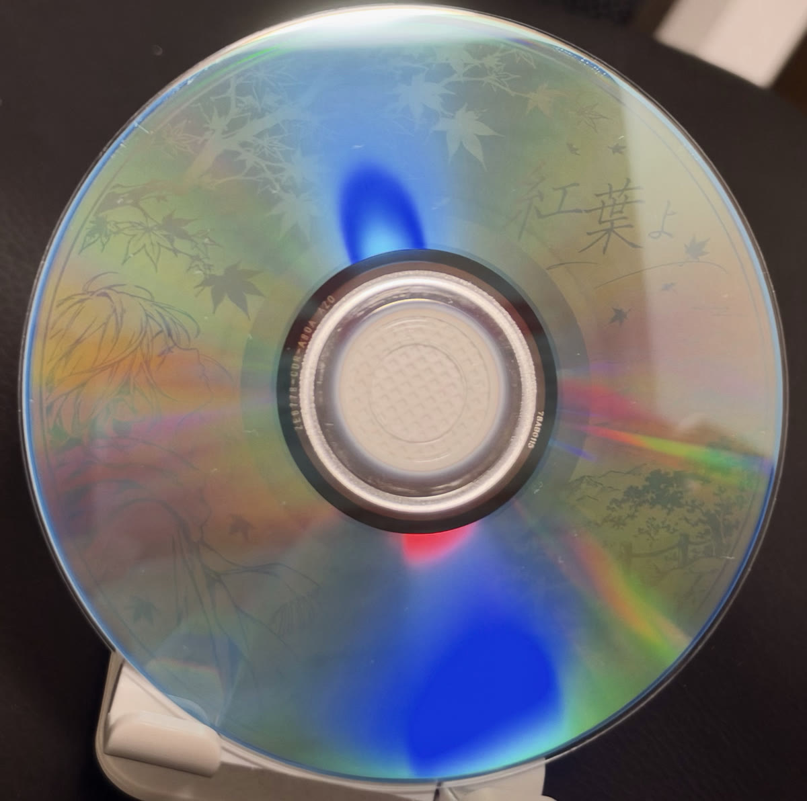

# CDArtTrack

[English](README.md)

制作一张**能在普通 CD 机上播放音乐**、刻录面上又**显示图案**的 CD-R。

歌曲以普通 CD-DA 音轨的形式写在盘的内圈。其余部分是一条 Mode 1 数据轨，其中的字节由
[Disc Image Studio](https://github.com/JiaFeiMiao-K-Cat/DiscImageStudio) 排列好，
刻录后在盘面上形成肉眼可见的图案。CD 机不会播放数据轨，所以听到的只有音乐。

```
 中心 ── 不可刻录 ── 音轨 ── 2 秒静音 ── 图案（数据轨）── 外缘
```



*Verbatim SR80SP50V1（AZO），使用
[`calibrations/verbatim-sr80sp50v1-mcc-78ab0114-0115.calibration.json`](calibrations/verbatim-sr80sp50v1-mcc-78ab0114-0115.calibration.json) 刻录。
内圈是音乐，图案从音乐区外侧开始。*

CDArtTrack 是一个只用 Python 标准库的脚本，负责把这些环节串起来：

| 命令 | 作用 |
|------|------|
| `layout` | 根据歌曲时长算出图案从哪个半径开始，并生成设计用的模板 PNG |
| `art` | 调用 Disc Image Studio 的命令行版生成整盘图案镜像（`.iso`），可以直接读取它的 `.calibration.json` |
| `build` | 把歌曲和图案拼接成 `.wav` + `-art.bin` + `.cue` + cdrdao 用的 `.toc`（含 CD-Text） |
| `verify` | 仅限 Linux：核对刻好的盘（CD-Text、图案前的静音、数据轨内容） |

本项目与 Disc Image Studio 无关，只是调用它的命令行版。

## 需要

- Python 3.8 以上
- [Disc Image Studio](https://github.com/JiaFeiMiao-K-Cat/DiscImageStudio/releases) 的命令行版（`disc-image-studio`），用来生成图案
- [cdrdao](https://cdrdao.sourceforge.net/) 1.2.5 以上，用来刻录带 CD-Text 的 `.toc`。不需要 CD-Text 的话，任何支持混合模式 CUE 的刻录软件都可以
- ffmpeg（可选），用来把歌曲转成 CD 格式
- 空白 CD-R，以及支持 DAO/SAO 刻录的刻录机

## 流程

### 1. 获取盘片几何参数

只有生成器准确知道**你手上这种盘**的螺旋形状（内外半径、扇区数、轨距系数），图案才能对齐。可以：

- 使用 Disc Image Studio 中与盘片相符的内置预设，或者
- 用 Disc Image Studio 图形界面的"辅助标定"实测，保存 `.calibration.json`。

实测能正确显示图案的校准文件收在 [`calibrations/`](calibrations/) 里：

| 文件 | 盘片 | ATIP | 模具编号（中心透明圈） |
|------|------|------|------------------------|
| [`verbatim-phono-r-cmc-cwlht-1744.calibration.json`](calibrations/verbatim-phono-r-cmc-cwlht-1744.calibration.json) | Verbatim Phono-R CD-R 80 分钟（日本版） | CMC Magnetics，359,846 扇区 | `CWLHT-1744` |
| [`verbatim-sr80sp50v1-mcc-78ab0114-0115.calibration.json`](calibrations/verbatim-sr80sp50v1-mcc-78ab0114-0115.calibration.json) | Verbatim SR80SP50V1 CD-R 80 分钟，AZO（日本版） | Mitsubishi Chemical，359,848 扇区 | `78AB0114`、`78AB0115` |

只能用于模具编号相同的盘。同一包 Phono-R 里还混有 `CWLHT-1579` 的盘，这份文件**不适用**于它们。

下面所有涉及几何的命令，都可以用 `--calibration 文件.calibration.json` 指定参数，也可以直接写
`--r0 --r1 --sectors [--usable-sectors] [--pitch-linear --pitch-quadratic --pitch-cubic]`。

> **同一包盘可能来自不同的模具。** 请查看中心孔周围透明圈上的刻印编号，不同模具要分别校准。
> 把一个模具的参数用在另一个模具的盘上，图案会被完全拧花。

### 2. 规划布局，设计图案

```sh
python3 cdarttrack.py layout --calibration my-disc.calibration.json \
    --duration 3:45 --duration 4:10 --template template.png
```

会输出以毫米和像素（2400 × 2400 画布）表示的各个半径，并生成模板：

- 深色：不可刻录
- 灰色：音乐区，这里不会有图案
- 细圆线：建议的安全区，离各边界约 2 毫米

设计要点：

- 用正方形画布。画布中心是光盘中心，画布边缘是可刻录区的外缘。
- 对比度要高。只有明暗起作用，白底黑图效果最好。细于约 0.3 毫米的线条容易消失。
- CD-R 上的图案很淡，要用手电筒这类点光源斜照着看。

### 3. 把歌曲转成 CD 格式

```sh
ffmpeg -i song.flac -af aresample=resampler=soxr -ar 44100 -ac 2 -sample_fmt s16 song.wav
```

### 4. 生成整盘图案

```sh
python3 cdarttrack.py art --calibration my-disc.calibration.json \
    --image artwork.png --output art.iso --dis /path/to/disc-image-studio
```

会生成 `art.iso` 和 `art.iso.json`。图案覆盖整张盘，`build` 只保留音乐以外的部分。

### 5. 生成刻录文件

```sh
python3 cdarttrack.py build --art art.iso --out-dir out --name mydisc \
    --cdtext examples/cdtext.example.json song1.wav song2.wav
```

| 输出 | 内容 |
|------|------|
| `mydisc.wav` | 歌曲（补齐到整扇区）加 2 秒数字静音 |
| `mydisc-art.bin` | 图案扇区（Mode 1，每扇区 2048 字节） |
| `mydisc.toc` | cdrdao 用的刻录文件，含 CD-Text |
| `mydisc.cue` | 其他刻录软件用的刻录文件，不含 CD-Text |
| `mydisc.layout.json` | 供 `verify` 使用 |

CD-Text 用 JSON 描述，每个语言块各写一个值，参见
[`examples/cdtext.example.json`](examples/cdtext.example.json)。编码可以用
`MS_JIS`（日文）、`ISO_8859_1`、`ASCII`。大部分播放器只显示第 0 块，想显示的语言请放在最前面。

### 6. 用 cdrdao 刻录

请**在输出目录里**运行 cdrdao，因为 TOC 里的文件名是相对于当前目录的。

```sh
cd out
cdrdao simulate --device /dev/sr0 --driver generic-mmc -n mydisc.toc
eject /dev/sr0 && eject -t /dev/sr0      # 模拟刻录之后要重新载入光盘
cdrdao write    --device /dev/sr0 --driver generic-mmc --speed 16 -n mydisc.toc
```

### 7. 核对（Linux）

```sh
eject /dev/sr0 && eject -t /dev/sr0
python3 cdarttrack.py verify --device /dev/sr0 --layout out/mydisc.layout.json \
    --cdtext examples/cdtext.example.json
```

## 踩过的坑

- **数据轨的预间隙会被播成巨大的噪音。** CD 规格要求数据轨前面有 2 秒预间隙，里面是加扰过的
  Mode 1 扇区。很多 CD 机会把下一轨的预间隙当成上一轨的结尾来播放，结果最后一首歌之后会冒出约
  2 秒接近满幅的噪声。因此 `build` 默认使用 `--data-pregap 0`：2 秒数字静音结束的地方，正好就是
  数据轨的起点，CD 机播到那里就会停。（测试用的刻录机还会自动把这段静音标记为数据轨的 index 00。）图案不受影响。
  需要标准布局时，请用 `--data-pregap 150`。
- **cdrdao 1.2.5 会把 CD-Text 写坏。** 它新加的字符编码功能会丢掉字符串末尾的结束符，
  所有名字都会粘在一起（如 "AlbumTrack OneDisc Art"）。CDArtTrack 把每个 CD-Text 字段
  都以带结束符的二进制数据写入，绕过了这个 bug。另外，`cdrdao read-toc` 读取 MS-JIS 的 CD-Text
  时可能会崩溃，请改用 `cdarttrack.py verify` 来读取。
- **`cdrdao simulate` 之后要重新载入光盘。** 刻录机会一直报告模拟后的状态，下一次运行会把盘当成"已写入"。
- **虚拟机里模拟出来的光驱，可能在刻录中途失败。** 如果刻录机的缓冲区反复被用空，
  请把真实设备直通给虚拟机，或者直接在宿主机上刻录。
- **品牌既说明不了染料，也说明不了几何。** ATIP 里的生产厂可以参考，但染料类型那一项只能当提示，
  并且要按模具分别校准。
- 非常老的 CD 机可能会尝试播放数据轨。现代的 CD 机、车载音响和电脑都会跳过它。

## 许可证

GPL-3.0-or-later，见 [LICENSE](LICENSE)。
